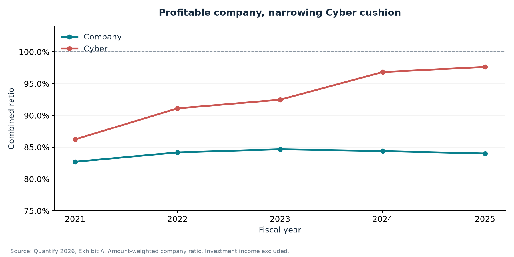
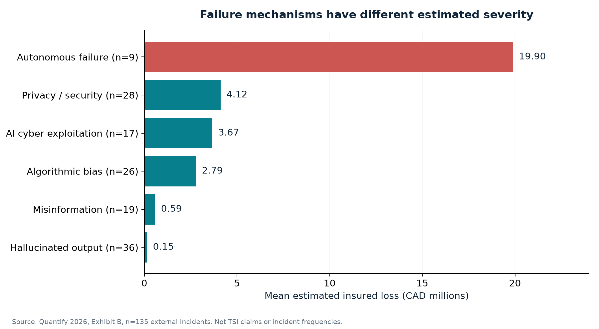

# AI Liability Insurance: A Selective Entry Strategy

**Quantify Case Competition 2026 · Team Analysts · TileShield Insurance**

An insurance strategy case study combining underwriting analysis, external AI incident severity, and transparent pilot economics. The decision: whether a mid-sized Canadian insurer should enter AI liability insurance, and what must be true before it does.

**Recommendation:** prepare a limited endorsement offer for verified existing SME customers, then launch only if customer demand, technical pricing, policy wording and aggregate capacity meet explicit gates. Retain a defined capability-building period if those gates fail.

[Read the presentation](presentations/final-presentation.pdf) · [Editable PowerPoint](presentations/final-presentation.pptx) · [Methods](docs/methodology.md) · [Pilot design](docs/pilot-design.md)

## Key findings

| Evidence | Result | Decision implication |
|---|---|---|
| 2025 company underwriting | 84.0% combined ratio; CAD 133.45M underwriting profit | A profitable foundation, with capital and reinsurance still unobserved |
| 2025 Cyber underwriting | 97.6% combined ratio | Little existing margin for additional uncertainty |
| 135 external AI incidents | Nine autonomous failures represent 40.2% of estimated loss | Segment failure mechanisms and stress common dependencies |
| Candidate supervised output-error group | 28 observations; CAD 167,643 average estimated loss | A useful starting group, requiring individual coverage mapping |
| Log-loss model | R² 95.0%; sequential industry share falls from 22.24% to 0.32% when failure type enters first | Attribution depends on order; avoid treating shares as independent causal drivers |





## What the analysis changes

- Separates profitable underwriting from available risk capital.
- Distinguishes incident counts from exposure-based claim frequency.
- Replaces causal oversight claims and blanket premium discounts with conditional associations.
- Compares product structures under comparable coverage scope. A standalone product can also be narrow; capability building can also create useful information.
- Adds a candidate-subset analysis, break-even economics and a common-vendor stress scenario.
- Moves technical detail into the appendix and speaker notes, reducing the main presentation to 10 slides plus 4 appendix slides.

## Reproduce the work

The notebooks were executed with Python 3.12 and the direct dependency versions pinned in `requirements.txt`. Run commands from this repository's root.

```bash
python -m venv .venv
source .venv/bin/activate
python -m pip install -r requirements.txt
python -m unittest discover -s tests -v
```

Windows activation: `.venv\Scripts\activate`.

### With only the public repository

The executed notebooks retain their aggregate outputs. You can regenerate the figures from the checked-in aggregate tables and rerun the pilot economics without organizer data:

```bash
python -m src.plots
python scripts/run_notebooks.py --pilot-only
```

### With an authorized organizer workbook

Place the combined `Exhibits 2026 Quantify Case Study.xlsx` at `data/raw/exhibits.xlsx`, or set `QUANTIFY_WORKBOOK` to its local location. Then run:

```bash
python -m src.analysis --workbook data/raw/exhibits.xlsx --figures
python scripts/run_notebooks.py
```

The source workbook is not redistributed. The two historical-data notebooks require it to recompute from records; their saved outputs remain readable without it. See [data access and provenance](data/README.md).

## Repository guide

| Path | Contents |
|---|---|
| `analysis/financial-analysis.ipynb` | Financial metrics, unit conversion and amount-weighted results |
| `analysis/incident-severity-analysis.ipynb` | Loss segmentation, oversight, model-order sensitivity and random-fold validation |
| `analysis/pilot-economics.ipynb` | Assumption-driven economics, contract limits and vendor concentration |
| `src/` | Shared calculations and figure generation |
| `data/processed/` | Aggregate evidence tables and machine-readable results |
| `docs/` | Methods, product design, limitations, revision history and concise Q&A |
| `presentations/` | Searchable PDF, editable PPTX and the slide script |

PowerPoint charts contain editable snapshots of the displayed data. Recomputing the Python analysis does not automatically update the PPTX or PDF; review and refresh those presentation files when inputs change.

## Team and project history

The original competition work was completed by **Team Analysts**:

- Charles - Jiaming Han
- Lucas - Haojie Wang
- Hanson - JunHan Qian
- Anthony - Minghao Sun

The portfolio revision preserves the original names and 2026 competition identity. It adds reproducible analysis and a shorter presentation. It does not represent an unchanged competition submission or a new insurance product launch. [Contributions and authorship](docs/contributions.md) distinguish the original team work from the repository revision without inventing individual task assignments.

## Interpretation limits

Exhibit B contains external estimated insured losses, not TSI claims. There is no exposure denominator for incident frequency. Oversight associations are observational; fitted log-loss coefficients do not establish premium discounts. Pilot parameters are illustrative assumptions. A year without claims does not validate long-tail profitability, and stopping new business does not extinguish existing obligations.

The original AIID/CSET and DAIL historical extracts were not supplied. Their numerical summaries are not treated as reproduced evidence in the revised presentation. See [limitations](docs/limitations-and-improvements.md) and [sources](docs/sources.md).

Original case materials remain subject to their owners' rights. No blanket reuse license is granted by this repository. See [NOTICE](NOTICE.md).
